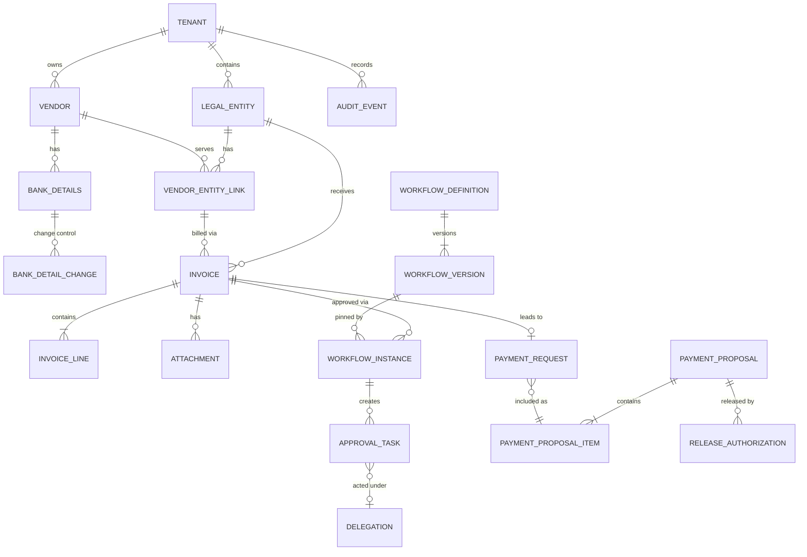

# VPMS Data Model

Status: Accepted (Phase 0 approved). Logical model; physical details (types, indexes) are finalised per phase.

Conventions
- Every tenant-owned table has `TenantId` (non-null, indexed first in composite keys) and an EF global query filter.
- Entity-scoped tables also carry `LegalEntityId`.
- All tables: `Id` (GUID, sequential), `CreatedAt/By`, `UpdatedAt/By`, `RowVersion` (optimistic concurrency).
- Money: `decimal(19,4)` plus ISO 4217 `CurrencyCode`. Dates stored UTC; calendar display (Hijri/Gregorian) is presentation.
- [E] = column-level encrypted. [H] = also stored as a keyed hash for lookup/duplicate checks.
- Each module uses its own schema (`customer`, `vendor`, `invoice`, `workflow`, `payment`, `treasury`, `erp`, `audit`).

## ER overview

## Customer Administration

**Tenant**: Id, Name, Slug, Status, DataRegion, DefaultLocale, DefaultCalendar, BrandingJson, CreatedAt.

**LegalEntity**: Id, TenantId, Code, LegalName (en/ar), CountryCode, BaseCurrency, TaxRegistrationNo [E], ErpCompanyCode,
Status. Unique (TenantId, Code).

**User / RoleAssignment / ApprovalAuthority** (summary): User (Id, TenantId, ExternalSubject, IdP, Email, Status,
Locale). RoleAssignment (UserId, RoleId, LegalEntityId nullable). ApprovalAuthority (UserId, LegalEntityId,
MaxAmount, CurrencyCode, DimensionScopeJson, ValidFrom, ValidTo). SoD conflict matrix is configuration data.

## Vendor

**Vendor**: Id, TenantId, LegalName (en/ar), TradeName, CountryCode, TaxId [E][H], RegistrationNo [E], Status
(Invited, Submitted, UnderReview, Active, Suspended, Rejected), VerificationStatus, PortalAccountId.
Unique (TenantId, TaxId hash) where TaxId present.

**VendorEntityLink**: Id, TenantId, VendorId, LegalEntityId, ErpVendorAccount, PaymentTermsCode, DefaultCurrency,
DefaultTaxCode, DefaultExpenseDimensionsJson, WithholdingRuleCode, Status. Unique (VendorId, LegalEntityId).
Holds the per-entity accounting rules; the same vendor can have a different link per entity.

**VendorDocument**: Id, VendorId, Type, AttachmentId, ExpiresOn, VerifiedBy, VerifiedAt.

**BankDetails**: Id, TenantId, VendorId, AccountName, BankName, SwiftBic, CountryCode, CurrencyCode,
IBAN [E][H], AccountNumber [E][H], Status (Pending, Verified, Superseded, Revoked), EffectiveFrom, VerifiedAt.
Only one `Verified` row is active per vendor and currency. Rows are never edited in place once Verified.

**BankDetailChange** (change control): Id, TenantId, VendorId, BankDetailsId (target, nullable for new),
ProposedValuesEncrypted [E], Reason, Source (Vendor portal, Internal), MadeBy, MadeAt, Status (Pending,
Approved, Rejected, Cancelled, Expired), CheckedBy, CheckedAt, CheckerComment, CallbackVerificationRef.
Invariants: `CheckedBy != MadeBy`; checker needs `Vendor.BankDetails.Approve`; change takes effect only on
Approved; any open change blocks payment release for that vendor.

## Invoice

**Invoice**: Id, TenantId, LegalEntityId, VendorId, VendorEntityLinkId, InvoiceNumber, InvoiceDate, DueDate,
CurrencyCode, SubtotalAmount, TaxAmount, TotalAmount, PoReference, Source (Manual, Portal, Email, Document),
Status (Received, InVerification, Exception, PendingApproval, Approved, Rejected, Returned, PaymentRequested,
Paid-in-ERP, Cancelled), ApprovedDataHash (set on approval, basis for material-change detection),
SupplierTaxInvoiceRef (e.g. supplier's ZATCA UUID/QR, informational), ErpDocumentId, DuplicateKeyHash,
Version. Index: unique-ish (TenantId, LegalEntityId, VendorId, InvoiceNumber, TotalAmount, InvoiceDate) with
fuzzy variants handled by the verification engine; matches become `InvoiceException`, not silent drops.

**InvoiceLine**: Id, InvoiceId, LineNo, Description, Quantity, UnitPrice, LineAmount, TaxCode, TaxAmount,
PoLineRef, DimensionsJson (cost center, project, etc.). Unique (InvoiceId, LineNo).

**Attachment**: Id, TenantId, LegalEntityId, OwnerType, OwnerId, FileName, ContentType, SizeBytes, Sha256,
StorageKey (`/{tenant}/{entity}/...`), ScanStatus (Pending, Clean, Infected), UploadedBy, UploadedAt.

**VerificationResult / InvoiceException**: Id, InvoiceId, RuleCode, Severity, Outcome, Detail, ResolvedBy,
ResolvedAt, Resolution. Rule configuration: `VerificationRuleSet` per LegalEntity (rule codes, thresholds,
tolerances, on/off flags).

## Workflow

**WorkflowDefinition**: Id, TenantId, LegalEntityId (nullable = tenant-wide), Key, Name, Subject (Invoice,
PaymentRequest, BankDetailChange...), Status.

**WorkflowVersion**: Id, DefinitionId, VersionNo, GraphJson, SchemaVersion, Status (Draft, Published, Retired),
PublishedBy, PublishedAt, ContentHash. Published versions are immutable. Unique (DefinitionId, VersionNo).

**ApprovalMatrixRule**: Id, LegalEntityId, Priority, ConditionsJson (amount range, vendor, dimension),
ApproverResolution (role, user, manager chain), Levels. Referenced by `MultiLevel` steps.

**WorkflowInstance**: Id, TenantId, LegalEntityId, VersionId (pinned), SubjectType, SubjectId, SubjectDataHash,
StartedBy (maker), State, StartedAt, CompletedAt, SupersededByInstanceId.

**ApprovalTask**: Id, InstanceId, StepKey, AssignedTo (user or role), OnBehalfOfDelegationId, Status (Open,
Approved, Rejected, Returned, Cancelled, Escalated), DecidedBy, DecidedAt, Comment, DueAt, ReminderCount,
EscalatedTo. Constraint enforced in engine and by check: `DecidedBy != Instance.StartedBy`.

**WorkflowHistory**: Id, InstanceId, Event, Payload, At (append-only mirror of engine events).

**Delegation**: Id, TenantId, DelegatorId, DelegateId, LegalEntityId (nullable), ScopeJson, ValidFrom, ValidTo,
Status, CreatedBy. Delegates cannot exceed the delegator's authority and cannot approve items they made.

**Timer**: Id, TenantId, Kind (Reminder, Escalation, DelegationStart/End, Deadline), DueAt, PayloadJson,
LeaseOwner, LeaseUntil, Status.

## Payments and Treasury

**PaymentRequest**: Id, TenantId, LegalEntityId, VendorId, InvoiceId, Amount, CurrencyCode, DueDate,
BankDetailsId (snapshot reference), InvoiceApprovedDataHash, Status (Created, InProposal, Released,
Invalidated, Cancelled), CreatedBy.

**PaymentProposal**: Id, TenantId, LegalEntityId, ProposalNo, GroupingKey (vendor, due date, company,
currency), CurrencyCode, TotalAmount, Status (Draft, PendingApproval, Approved, ReadyForRelease, Released,
Invalidated, Cancelled), CreatedBy, ApprovedBy, WorkflowInstanceId.

**PaymentProposalItem**: Id, ProposalId, PaymentRequestId, Amount, ItemStatus.

**ReleaseAuthorization**: Id, TenantId, ProposalId, AuthorizedBy, AuthorizedAt, Decision, RecheckResultJson
(bank-details status, invoice hash, SoD evaluation), InstructionRef (generated file/API payload id),
InstructionHash, Signature. Invariant: `AuthorizedBy` is not the maker of the proposal, not an approver of any
included invoice, and not the checker of the vendor's bank-detail change in scope.

**PaymentInstruction**: Id, ProposalId, Format, StorageKey, Hash, Status (Prepared, HandedOff, Acknowledged).
Prepared only; no execution status for bank transfers exists in v1.

## ERP

**ErpConnection**: Id, TenantId, Provider (D365F&O), BaseUrl, AuthMode, SecretRef (Key Vault name), Status.
**ErpEntityMapping**: LegalEntityId, ErpCompany (dataAreaId), DimensionMappingJson.
**ErpSyncRecord**: Id, TenantId, LegalEntityId, ObjectType, ObjectId, IdempotencyKey (unique), Direction,
ErpReference, Status, Attempts, LastError, NextAttemptAt.
**Outbox / Inbox**: MessageId, TenantId, Type, Payload, CreatedAt, ProcessedAt (Inbox unique on MessageId).
**ReconciliationRun / ReconciliationItem**: Run summary; item with VpmsState, ErpState, MismatchType,
Resolution workflow fields.

## Audit

**AuditEvent** (append-only): Id, TenantId, LegalEntityId (nullable), Sequence (per tenant, unique with TenantId),
OccurredAt, ActorType, ActorId, OnBehalfOfId, Action, EntityType, EntityId, CorrelationId, IpAddress,
BeforeHash, AfterHash, ChangeSummaryJson (redacted), PrevHash, Hash.
Permissions: INSERT/SELECT only; update/delete blocked by role and trigger. **AuditAnchor**: TenantId, Sequence,
Hash, AnchoredAt, ExternalRef.

## Encrypted and sensitive columns

Bank IBAN/account number, vendor tax ID and registration number, legal entity tax number, proposed bank values in
change records, ERP/connection secrets (only Key Vault references stored). Lookup uses keyed hashes (HMAC) so
duplicate detection works without decrypting. See ADR-0004.

## Key constraints to prove with tests

- Cross-tenant: no query returns rows of another tenant; writes with a foreign `TenantId` fail.
- `BankDetailChange.CheckedBy <> MadeBy`; effect only when Approved.
- `ApprovalTask.DecidedBy <> WorkflowInstance.StartedBy`; `ReleaseAuthorization.AuthorizedBy` not among invoice approvers.
- Published `WorkflowVersion` rows cannot be modified; instances keep their `VersionId`.
- `AuditEvent` rows cannot be updated or deleted; chain verifies.

## Phase 2 as built (differences from the logical model above)

- Schemas: `customer`, `identity`, `audit`, `documents`, `vendor`, `portal`.
- `BankDetails.Source` moved to the change record (`BankDetailChange.Source`: Staff, VendorPortal); `BankDetails` has
  `MaskedAccount` and blind indexes (`IbanIndex`, `AccountNumberIndex`); proposed values live on the pending
  `BankDetails` row (encrypted) rather than in a JSON blob. `BankDetailChange` adds `ReplacesBankDetailsId`,
  `ProposedBankDetailsId`, `ExpiresAt` and `CallbackVerificationRef`. Database guards are listed in ADR-0008.
- `VendorRequest` and `VendorMessage` implement the staff/vendor thread; `VendorDocument` links an `Attachment`
  (statuses Uploaded, Verified, Rejected) and records who uploaded it.
- `Attachment.ScanStatus` includes `Failed`; scanner signature and timestamps are stored.
- Portal: `VendorUser` (password hash, encrypted TOTP secret, lockout counters, MFA-reset state), `VendorInvite`
  (hashed token, purpose, expiry, single use), `VendorRecoveryCode` (hashed).
- `PendingRoleAssignment` lets an administrator grant a role to someone who has not signed in yet.
- Every vendor-owned table has `VendorId` and the vendor query filter; every tenant-owned table keeps `TenantId`, the
  tenant filter and an RLS policy.
